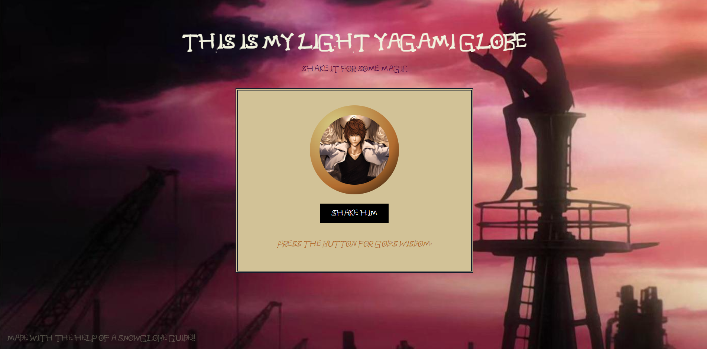

This is a Light Yagami Globe! Shake him to hear some of his wisdom.

I made this using the 'HTML, CSS & JS' guide from the Hack Club. (https://snowglobe.hackclub.com/html-css-js)

This project will allow me to be eligible for the Snowglobe hackathon hosted by the Hack Club!

Once I had made the base website, I decided to change many aspects to fit the character "Light Yagami" from Death Note.

Here are all the changes I made. I learned a lot of these outside of the tutorial: 
- Changed the snow globe picture to Light Yagami
- Changed all coloring to fit color scheme of images better
- Learned how to add a background image and adjust its properties, making sure it doesn't repeat and fits the entire screen
- Added background music that turns on once the website is clicked. Autoplaying as soon as website opened didn't work
- Learned to reduce text opacity
- Changed quotes to be what the character said
- Learned how to import a font from the Internet
